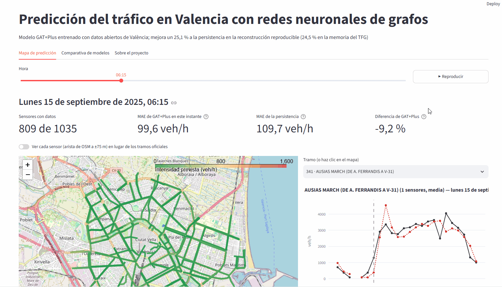
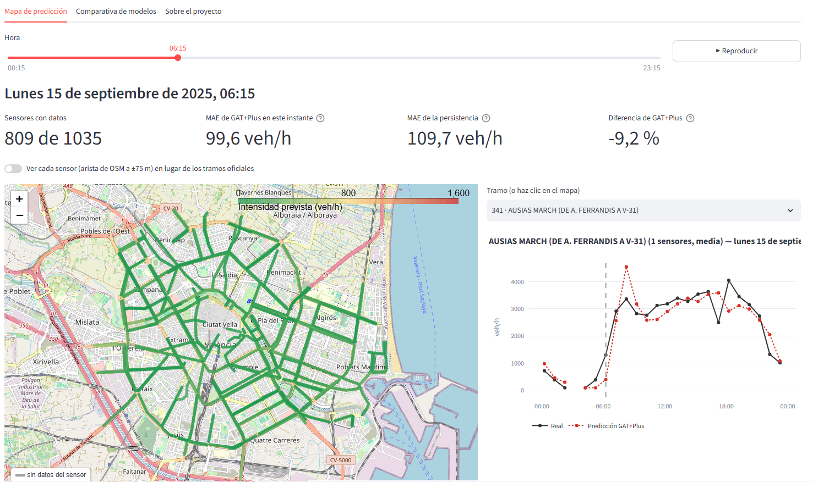
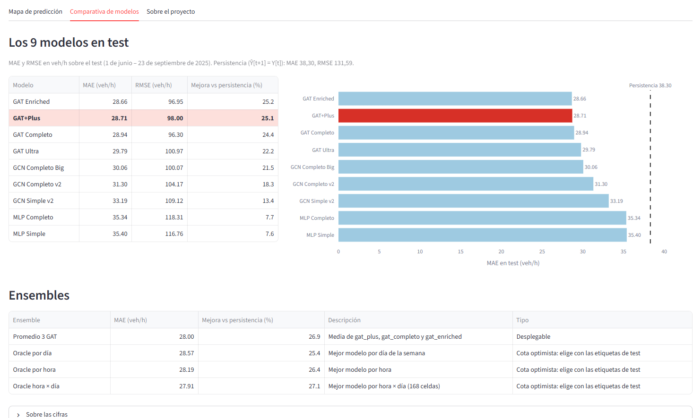
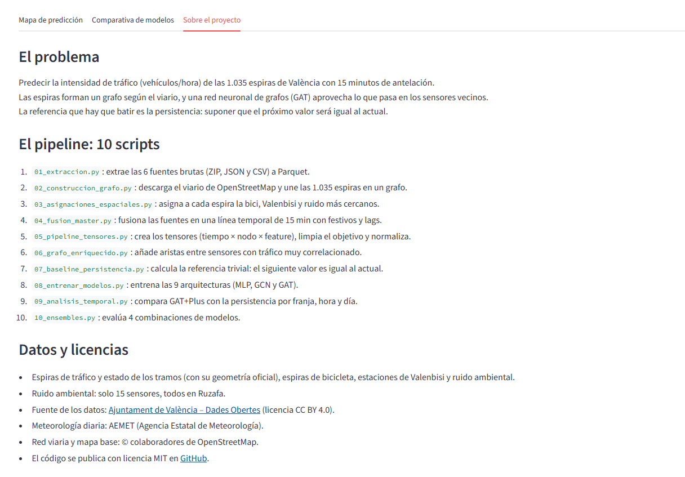

[](https://github.com/elalex22/trafico-valencia-tfg/actions/workflows/ci.yml)

# Predicción del tráfico en Valencia con redes neuronales de grafos

**Autor:** Alejandro Navarro del Castillo\
**Trabajo de Fin de Grado — Grado en Ciencia de Datos, Universitat Politècnica de València**

GAT+Plus, una red de atención sobre grafos, predice la intensidad de tráfico de 1.035 espiras de València con 15 minutos de antelación: MAE de 28,71 veh/h, un 25,1 % mejor que la persistencia.

**Demo en vivo:** DEMO_URL



## El problema

Predecir cuántos vehículos por hora pasarán por cada espira dentro de 15 minutos.
Las espiras forman un grafo según el viario: lo que pasa en una calle anticipa lo que pasará en las vecinas.
La referencia que hay que batir es la persistencia: suponer que el próximo valor será igual al actual.

## Datos

- **Ajuntament de València – Dades Obertes:** espiras de tráfico (intensidad horaria), estado y geometría de los tramos, espiras de bicicleta, estaciones de Valenbisi y ruido ambiental (solo 15 sensores, todos en Ruzafa).
- **AEMET:** meteorología diaria.
- **OpenStreetMap:** red viaria (grafo de las espiras) y mapa base de la demo.

Periodos: entrenamiento de marzo de 2023 a mayo de 2024, validación de junio a septiembre de 2024 y test del 1 de junio al 23 de septiembre de 2025.

Fuente de los datos: Ajuntament de València – Dades Obertes ([licencia CC BY 4.0](https://www.valencia.es/web/gobierno-abierto/cas/datos-abiertos/reutilizacion/politica-de-uso-datos-abiertos/politica-de-uso)). Meteorología: AEMET. Red viaria y mapa base: © colaboradores de OpenStreetMap.

## Pipeline

Diez scripts que se ejecutan en orden desde la raíz. Todo lo que generan va a `pipeline_v2_recon/` (`data/`, `models/` y `resultados/`); las carpetas de datos brutos solo se leen.

| Script | Qué hace | Qué genera |
|---|---|---|
| `01_extraccion.py` | Extrae las 6 fuentes brutas (ZIP, JSON y CSV) a Parquet y limpia meteorología y coordenadas | `data/processed/*.parquet` |
| `02_construccion_grafo.py` | Descarga el viario de OSM, ajusta cada espira a su arista y construye el grafo; asigna cada espira a un tramo oficial | `data/grafo/node_order_1035.csv`, `edge_index_final.npy`, `espira_to_tramo.csv` |
| `03_asignaciones_espaciales.py` | Asigna a cada espira la espira de bici, la estación de Valenbisi y el sensor de ruido más cercanos | `data/master_final/asignaciones_espaciales.csv` |
| `04_fusion_master.py` | Fusiona las fuentes en una línea temporal de 15 min con festivos, rachas de sensor roto, interpolación y lags | `data/master_final/master_{split}.parquet` |
| `05_pipeline_tensores.py` | Crea los tensores (tiempo × nodo × variable), limpia el objetivo (log1p) y normaliza | `data/tensors_final/*.npy`, `config.json`, `stats.json` |
| `06_grafo_enriquecido.py` | Añade aristas entre espiras con tráfico muy correlacionado | `data/grafo/edge_index_enriched.npy` |
| `07_baseline_persistencia.py` | MAE y RMSE de la persistencia (Ŷ[t+1] = Y[t]) | `resultados/baseline.json` |
| `08_entrenar_modelos.py` | Entrena las 9 arquitecturas (MLP, GCN y GAT) | `models/*.pt`, `resultados/entrenamiento.json` |
| `09_analisis_temporal.py` | Compara GAT+Plus con la persistencia por franja, hora y día | `resultados/analisis_temporal.json` |
| `10_ensembles.py` | Evalúa 4 combinaciones de modelos | `resultados/ensembles.json` |

`08` no fija semilla (cada entrenamiento varía un 1–3 %) y `06` es sensible al umbral de correlación. Los pesos del repositorio no se reentrenan.

## Resultados

### Los 9 modelos

MAE y RMSE en test (veh/h), con los pesos guardados evaluados sobre los datos regenerados ([`metricas.json`](pipeline_v2_recon/demo/metricas.json)).

| Modelo | MAE | RMSE | Mejora frente a la persistencia |
|---|---|---|---|
| Persistencia | 38,30 | 131,59 | — |
| GAT Enriched | 28,66 | 96,95 | 25,2 % |
| **GAT+Plus** | **28,71** | **98,00** | **25,1 %** |
| GAT Completo | 28,94 | 96,30 | 24,5 % |
| GAT Ultra | 29,79 | 100,97 | 22,2 % |
| GCN Completo Big | 30,06 | 100,07 | 21,5 % |
| GCN Completo v2 | 31,30 | 104,17 | 18,3 % |
| GCN Simple v2 | 33,19 | 109,12 | 13,4 % |
| MLP Completo | 35,34 | 118,31 | 7,7 % |
| MLP Simple | 35,40 | 116,76 | 7,6 % |

- **Memoria frente a reconstrucción.** `pipeline_v2_recon` reconstruye el pipeline del TFG. La memoria da una persistencia de 37,55 veh/h (Tabla 6.1, p. 50) y GAT+Plus con 28,35 y una mejora del 24,5 % (Tabla 6.2, p. 53). La reconstrucción da 38,30, 28,71 y 25,1 %. Las coberturas de los splits también difieren de la Tabla 4.2, y el grafo de OSM se descargó de nuevo (2.855 aristas en lugar de 2.863; los 1.035 nodos coinciden).
- **GAT Enriched queda 0,05 veh/h por delante** en la reconstrucción, una diferencia despreciable. La demo usa GAT+Plus por coherencia con la memoria y con los análisis temporal (`09`) y de ensembles (`10`).
- **Ensembles.** El promedio de 3 GAT, el único ensemble desplegable, baja el MAE a 28,00 (de `resultados/ensembles.json`, sin recalcular con el grafo regenerado). Los «oracle» no se incluyen: eligen el modelo mirando las etiquetas de test.

### Análisis adicional

La intensidad de las espiras es horaria y el valor nuevo llega a y cuarto: en :00, :30 y :45 el valor real es el anterior. Para descartar que la mejora venga de esos instantes triviales o de la congelación de junio ([`analisis_adicional.json`](pipeline_v2_recon/demo/analisis_adicional.json)):

| Instantes evaluados | GAT+Plus | Persistencia | Mejora | Instantes |
|---|---|---|---|---|
| Test completo | 28,71 | 38,38 | 25,2 % | 11.020 |
| Solo :15 | 113,49 | 152,33 | 25,5 % | 2.755 |
| Solo :15, sin el 1–12 de junio | 126,39 | 169,81 | 25,6 % | 2.472 |

La mejora se mantiene entre el 25,2 % y el 25,6 %. Casi todo el error de ambos modelos está en los :15. Aquí la persistencia se calcula sobre los mismos instantes que GAT+Plus (desde el 1 de junio a las 05:00), de ahí 38,38 en lugar de 38,30.

## Hallazgos de calidad de datos

- **Ocho meses corruptos.** De octubre de 2024 a mayo de 2025 la fuente oficial de espiras dio casi todo ceros: entre el 0 y el 34 % de valores positivos por mes (noviembre y diciembre, el 100 % a cero), frente al 64–69 % de antes y el 66–74 % de después. El portal lo reconocía («temporalmente con errores de procesamiento») y esos meses quedan fuera de los splits (memoria, p. 31 y 37).
- **Junio congelado.** Del 1 al 12 de junio de 2025 todos los sensores repiten el mismo valor durante 272 horas (11,3 días, alrededor del 10 % del test). Las métricas lo incluyen.
- **Lag de 7 días contaminado.** Durante la primera semana de test (1–7 de junio de 2025), la variable `lag7d` procede del 25–31 de mayo, dentro del régimen corrupto.
- **Apagón del 29 de junio.** Desde las 9:00 no hay ningún dato de tráfico; la demo marca esas horas como no verificables.

## Capturas

**Mapa de predicción:** tramos coloreados por la intensidad prevista, métricas del instante y serie del día del tramo elegido.



**Comparativa de modelos:** los 9 modelos, los ensembles y las notas sobre las cifras.



**Sobre el proyecto:** problema, pipeline, datos y hallazgos.



## Cómo ejecutarlo

### Demo con Docker

```bash
docker build -t trafico-valencia .
docker run -p 8501:8501 trafico-valencia
```

Abre http://localhost:8501. La imagen (1,98 GB, torch solo CPU) solo contiene la app, la muestra de la demo (`pipeline_v2_recon/demo/`) y los pesos de GAT+Plus. Tiene un healthcheck en `/_stcore/health`.

### Demo sin Docker

Con Python 3.10, desde la raíz del repositorio (Windows):

```powershell
py -3.10 -m venv .venv
.venv\Scripts\python.exe -m pip install -r requirements-torch-cpu.txt -r requirements-app.txt
.venv\Scripts\python.exe -m streamlit run app/app.py
```

La app lee las predicciones precalculadas; el modelo solo se carga con el botón «Calcular en vivo con el modelo».

### Pipeline completo

Necesita los datos brutos (no incluidos) en seis carpetas de la raíz: `estat_trafic_VLC-main`, `espires_VLC2-main`, `espires_bici_VLC-main`, `valenbici-master`, `datos_tiempo` y `fusion_ruido_sensores`.

```powershell
.venv\Scripts\python.exe -m pip install -r requirements.txt
.venv\Scripts\python.exe 01_extraccion.py
# ... en orden, hasta
.venv\Scripts\python.exe 10_ensembles.py
```

`02` descarga el viario de OpenStreetMap. Si un antivirus intercepta HTTPS, la descarga puede fallar por certificados: añade su certificado raíz a la cadena de confianza en lugar de desactivar la verificación.

## Tests y CI

- **ruff** (`ruff check .`) revisa el código nuevo: `app/`, `tests/`, `verificar_resultados.py` y `analisis_adicional.py`. Los scripts del pipeline no se tocan.
- **pytest** (`pytest -q`, 44 tests) cubre la inferencia de una ventana, las predicciones precalculadas, la geometría del mapa, la app (con `streamlit.testing`), la coherencia de las métricas y la calidad de los datos (régimen corrupto, congelación de junio y baseline de 38,30). Los 4 tests que necesitan los datos completos (los Parquet de `01` y los tensores de `05`) se saltan solos si faltan.
- **GitHub Actions** ([`ci.yml`](.github/workflows/ci.yml)), en cada push y pull request a `main` y `demo-web`: ruff y pytest con Python 3.10 y torch CPU; y construcción de la imagen Docker con espera a que el healthcheck esté en *healthy*.

## Lecciones aprendidas

1. **Los datos oficiales hay que auditarlos.** Ocho meses de ceros y once días congelados llegaron sin más aviso que una etiqueta en el portal. Medir antes de modelar.
2. **Reproducir no es copiar.** OSM cambia, el entrenamiento sin semilla varía y torch no da el mismo último dígito en Windows y en Linux. Versiones fijadas, tests que verifican las cifras y comparaciones con tolerancia.
3. **El grafo ayuda.** Con las mismas entradas, el MLP mejora un 7,7 % a la persistencia, la GCN un 18,3 % y la GAT un 24,5 %: los vecinos en el viario aportan información y la atención aprende a qué vecinos atender.

## Licencia

Código bajo licencia MIT ([`LICENSE`](LICENSE)). Datos según la licencia de cada fuente (ver [Datos](#datos)).
